 
 

[**LinkedIn**](https://www.linkedin.com/in/mmnogueiro) &nbsp;·&nbsp; [**n.inf**](https://github.com/ninf-fct) &nbsp;·&nbsp; [**Clip a Room**](https://cliparoom.projectdev.net) &nbsp;·&nbsp; [**Email**](mailto:mm.nogueiro@campus.fct.unl.pt)

### `$ cat about.md`

- 🎓 3rd-year **Computer Science & Engineering** student at **NOVA FCT**
- 🧭 **Projects Department Manager & Treasurer** at **[n.inf](https://github.com/ninf-fct)**, the CS student group
- 💻 Full-stack roots: PHP & MySQL in production at **Fraqtory**, web portals at **ViaTecla**
- 🔐 Moving into **offensive security** — TryHackMe **SEC0** and **SEC1** done, web app pentesting next
- 🏫 Co-built **[Clip a Room](https://cliparoom.projectdev.net)**, a PWA that finds a free classroom at FCT in ~0.05s instead of ~30s

### `$ ls ./stack`

### `$ git log --journey`

  Knowledge isn't a destination, it's a direction.

