  
 

[**n.inf**](https://github.com/ninf-fct) · [**TryHackMe**](https://tryhackme.com/p/mm.nogueiro404)

### `$ cat about.md`

- 🎓 3rd-year **Computer Science & Engineering** student at **NOVA FCT**
- 🧭 **Projects Department Manager & Treasurer** at **[n.inf](https://github.com/ninf-fct)**, the CS student group

### `$ ls ./stack`

### `$ cat certs.txt`

